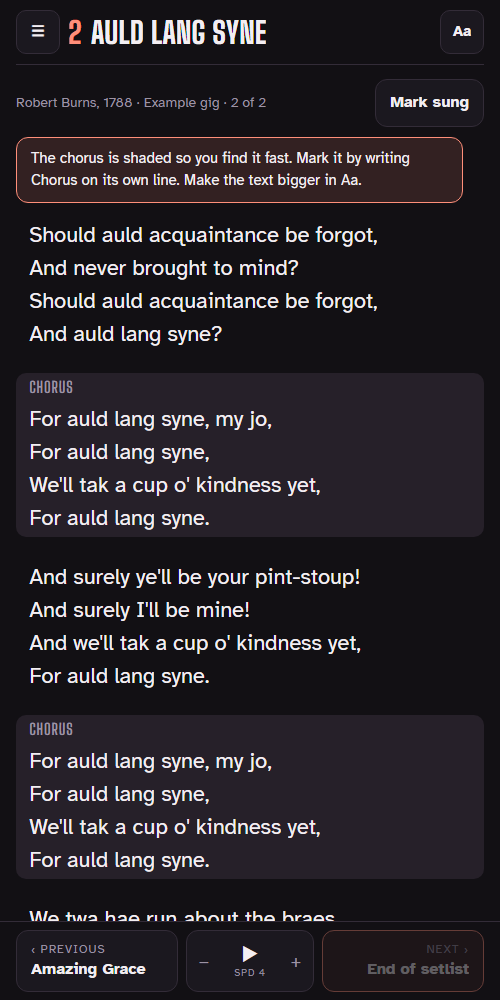

# Gig Lyrics

A lyrics app for singing at gigs from your phone or tablet. Big, readable lyrics, with the chorus shaded so you find your place fast.

**Open it:** https://vibesbg.github.io/lyrics/



## Use it for your band

1. Open the link. It starts with an example gig of two songs, so open them and try things out.
2. Tap **Make your own gig**, give it a name, and add your songs.
3. Type or paste each song's lyrics (see below). Split the gig into sets and put everything in order with ↑ ↓.
4. Add the app to your Home Screen. After the first visit it works without internet.

## Adding lyrics

Leave an empty line between verses. Write `Chorus` on its own line above the chorus and it gets shaded. Parts that repeat word for word are shaded too.

```
First verse line
Second verse line

Chorus
The chorus goes here
```

## What it does

- Big lyrics, adjustable text size, two columns on a tablet
- Auto-scroll, swipe between songs, and works with a Bluetooth page-turner pedal
- Search by title or by any line of the lyrics, across all gigs
- Notes per song, mark songs as sung
- Stage (dark) and Daylight looks, keeps the screen on
- English and Bulgarian

## Your data

Everything you add stays on your own device. Nothing is sent anywhere, and no lyrics are stored on this website. Use **Save gig to file** to keep a backup or send a gig (with its lyrics) to a bandmate, and **Load a file** to open one.

## For developers

One static page, no dependencies. `index.html` is built from `src/template.html`, `src/core.js` and `src/example.json`:

```
py -I src/build.py
```

Tests run in a browser: open `tests/core.test.html` directly, or serve the repo folder (`py -m http.server`) and open `tests/ui.test.html`.

---

Made by Dimitar Vasilev
